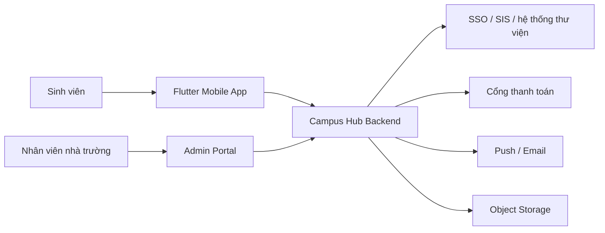
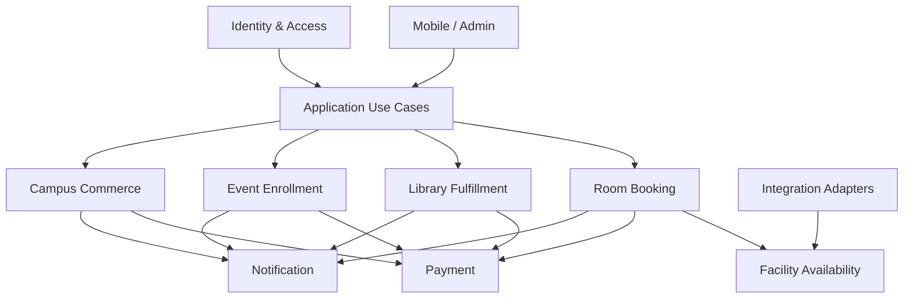

# Kiến trúc phần mềm Campus Hub

## 1. Mục tiêu kiến trúc

Campus Hub cần hỗ trợ bốn nhóm trải nghiệm:

1. Sinh viên tìm và đặt phòng học phù hợp mà không phải nộp đơn thủ công.
2. Sinh viên giữ sách trước, thư viện chuẩn bị và giao sách trong một hạn nhận rõ ràng.
3. Sinh viên đăng ký sự kiện với tư cách cá nhân hoặc đội thi.
4. Sinh viên mua vật phẩm mang thương hiệu trường như đồng phục, mũ, bình nước, sổ tay.

Kiến trúc ưu tiên:

- đúng và nhất quán khi nhiều người cùng đặt một tài nguyên;
- thay đổi chính sách theo từng trường mà không phải sửa toàn hệ thống;
- truy vết được quyết định, trạng thái và giao dịch;
- triển khai đơn giản cho MVP nhưng có đường tách module khi tăng trưởng;
- tích hợp được SSO, lịch học, thư viện và cổng thanh toán của trường.

## 2. Bối cảnh hệ thống



### Phạm vi Campus Hub sở hữu

- Trải nghiệm tìm kiếm, yêu cầu, theo dõi và nhận thông báo.
- Quy trình đặt phòng, giữ sách, đăng ký sự kiện và mua hàng.
- Áp dụng chính sách, điều phối thanh toán và lưu audit.
- Admin portal tối thiểu để nhân viên xử lý nghiệp vụ.

### Phạm vi hệ thống khác sở hữu

- Danh tính chính thức và tình trạng sinh viên nếu trường đã có SSO/SIS.
- Lịch học chính thức nếu trường đã có hệ thống thời khóa biểu.
- Nghiệp vụ thẻ và kết quả thanh toán cuối cùng thuộc cổng thanh toán.
- Quy trình kế toán/đối soát cuối cùng thuộc hệ thống tài chính của trường.

Campus Hub không sao chép vai trò của hệ thống nguồn. Nó giữ mã tham chiếu và đồng bộ
những thông tin cần thiết cho nghiệp vụ của mình.

### Hai project độc lập

Flutter Mobile và NestJS Backend là hai project độc lập, dù hiện được đặt trong cùng một
workspace để tiện phát triển:

- quản lý dependency riêng bằng `pubspec.yaml` và `package.json`;
- source, test, cấu hình môi trường và version release riêng;
- pipeline build/deploy riêng;
- không import source hoặc truy cập filesystem của nhau;
- chỉ giao tiếp qua REST contract được mô tả bằng OpenAPI;
- backend có thể deploy mà không build Flutter và ngược lại.

Không tạo thư viện “shared models” dùng đồng thời bởi Dart và TypeScript. Flutter client có
thể generate model/client từ OpenAPI, nhưng generated code thuộc project Flutter và được
version theo API contract.

## 3. Phong cách kiến trúc

Backend là **modular monolith**: một ứng dụng NestJS được triển khai như một đơn vị,
nhưng bên trong chia module theo ranh giới nghiệp vụ. Mỗi module có public contract,
logic và quyền sở hữu dữ liệu riêng.

Lựa chọn này giúp MVP có transaction nhất quán, debug và deployment đơn giản. Không dùng
microservices ở giai đoạn đầu. Một module chỉ được tách thành service riêng khi có bằng
chứng về tải, chu kỳ phát hành hoặc quyền sở hữu đội ngũ độc lập.

## 4. Các khối nghiệp vụ

Chi tiết actor, quy trình và quy tắc nằm trong
[business-architecture.md](business-architecture.md). Ở cấp phần mềm, hệ thống gồm:

| Khối                    | Trách nhiệm chính                                             | Không chịu trách nhiệm                          |
| ----------------------- | ------------------------------------------------------------- | ----------------------------------------------- |
| Identity & Access       | Phiên đăng nhập, hồ sơ ứng dụng, vai trò và quyền             | Xác minh học vụ gốc nếu đã có SIS               |
| Campus Directory        | Trường, cơ sở, đơn vị và thông tin tham chiếu                 | Quy trình đặt/mượn/đăng ký                      |
| Facility Availability   | Phòng, đặc tính, giờ mở cửa, lịch bận chính thức              | Đơn đặt phòng của sinh viên                     |
| Room Booking            | Yêu cầu, giữ chỗ, xác nhận, check-in, hủy và no-show          | Sở hữu lịch học chính thức                      |
| Library Fulfillment     | Tra cứu, giữ sách, chuẩn bị, hạn nhận, bàn giao và hoàn trả   | Biên mục chuyên sâu của hệ thống thư viện nguồn |
| Event Enrollment        | Công bố sự kiện, đăng ký cá nhân/đội, suất tham gia, check-in | Thanh toán tiền trực tiếp                       |
| Campus Commerce         | Catalog, giỏ hàng, đơn vật phẩm và giao/nhận                  | Vé sự kiện và booking phòng                     |
| Payment                 | Yêu cầu thu tiền, xác nhận, hoàn tiền, đối soát               | Quyết định đơn nghiệp vụ có hợp lệ hay không    |
| Notification            | Push/email và tùy chọn nhận tin                               | Thay đổi trạng thái nghiệp vụ                   |
| Policy & Administration | Chính sách, thao tác nhân viên, báo cáo, audit                | Đi vòng qua quy tắc của module nghiệp vụ        |
| Integration             | Đồng bộ hệ thống trường và chuyển đổi dữ liệu ngoài           | Chứa logic nghiệp vụ cốt lõi                    |

## 5. Quy tắc phụ thuộc giữa các module



Các nguyên tắc bắt buộc:

- Module không đọc hoặc ghi trực tiếp dữ liệu nội bộ của module khác.
- Giao tiếp đồng bộ qua public application service khi cần phản hồi ngay.
- Giao tiếp bất đồng bộ qua domain event cho thông báo, audit, analytics và đồng bộ.
- Payment phản hồi kết quả tiền; module nguồn mới quyết định chuyển trạng thái nghiệp vụ.
- Notification chỉ gửi thông điệp từ sự kiện đã xảy ra, không điều khiển quy trình.
- Integration chuyển đổi dữ liệu ngoài sang ngôn ngữ nội bộ; domain không phụ thuộc SDK ngoài.

## 6. Kiến trúc backend NestJS

Mỗi module nghiệp vụ dùng bốn lớp có hướng phụ thuộc vào trong:

```text
interface       Controller, consumer, DTO tại biên hệ thống
application     Use case, điều phối transaction, authorization theo hành động
domain          Quy tắc, trạng thái, policy, domain event
infrastructure  PostgreSQL repository, cache, queue và adapter bên thứ ba
```

Quy tắc lớp:

- `domain` không import NestJS, ORM, HTTP hoặc SDK thanh toán.
- `application` gọi port/interface, không phụ thuộc implementation hạ tầng.
- `interface` chỉ chuyển đổi input/output và gọi use case; không chứa nghiệp vụ.
- `infrastructure` có thể thay thế mà không sửa quy tắc domain.
- Không tạo abstraction hình thức cho class không có ranh giới cần thay thế hoặc kiểm thử.

## 7. Kiến trúc Flutter

Mobile tổ chức theo feature thay vì theo loại file toàn cục:

```text
lib/
|-- app/                 bootstrap, navigation, theme
|-- core/                network, session, error, observability, design system
`-- features/
    |-- rooms/
    |-- library/
    |-- events/
    |-- store/
    |-- payments/
    |-- notifications/
    `-- profile/
```

Mỗi feature chỉ dùng đủ ba vùng khi cần:

- `presentation`: page, widget và state/controller;
- `domain`: model/use case có ý nghĩa với trải nghiệm mobile;
- `data`: remote/local datasource và repository implementation.

Ứng dụng không tự quyết định giá, quyền đặt, availability cuối cùng hoặc kết quả thanh
toán. Mobile tối ưu trải nghiệm và hiển thị; backend là nguồn quyết định nghiệp vụ.

Flutter có repository/build lifecycle riêng. Mọi thay đổi API breaking phải được phát hành
theo version để mobile cũ vẫn hoạt động trong thời gian người dùng chưa cập nhật ứng dụng.

## 8. Phối hợp đồng bộ và bất đồng bộ

### Cần phản hồi đồng bộ

- kiểm tra quyền thực hiện hành động;
- xem khả dụng tại thời điểm yêu cầu;
- tạo yêu cầu giữ chỗ hoặc đăng ký;
- lấy trạng thái hiện tại;
- yêu cầu bắt đầu thanh toán.

### Xử lý bất đồng bộ

- hết hạn giữ chỗ/giữ sách/suất sự kiện;
- xác nhận từ webhook thanh toán;
- gửi push/email;
- đồng bộ lịch học và catalog;
- audit, analytics, báo cáo và đối soát.

Các tác vụ bất đồng bộ phải retry an toàn, không tạo giao dịch trùng và không giả định
event luôn đến đúng thứ tự.

## 9. Bảo mật và vận hành

- Phân quyền theo hành động và phạm vi trường/cơ sở, không chỉ theo tên role.
- Backend không tin giá, quyền hoặc trạng thái do client gửi lên.
- Dữ liệu cá nhân tối thiểu hóa, mã hóa khi truyền/lưu và có thời hạn lưu giữ.
- Không lưu thông tin thẻ; webhook phải xác thực chữ ký và chống xử lý lặp.
- Mọi thao tác nhạy cảm của nhân viên, thay đổi chính sách và hoàn tiền phải có audit.
- Mọi request và background job có correlation ID để truy vết xuyên module.
- Health check, metrics, structured log, error tracking và backup/restore là yêu cầu từ MVP.

## 10. Cấu hình và khả năng mở rộng nhiều trường

Các chính sách thay đổi theo trường phải là cấu hình có phiên bản, ví dụ:

- giờ mở cửa và thời lượng tối đa đặt phòng;
- phí, hạn thanh toán, điều kiện hủy và no-show;
- hạn nhận sách, tiền cọc/phí và chính sách hoàn;
- kích thước đội thi, capacity và thời gian đăng ký;
- phương thức thanh toán, nhận hàng và kênh thông báo.

Mặc định kiến trúc sẵn sàng cho nhiều trường, nhưng MVP chỉ triển khai một trường. Điều
này giữ được ranh giới dữ liệu mà không buộc sản phẩm phải giải bài toán SaaS quá sớm.

## 11. Thứ tự triển khai

1. Foundation: Identity, Campus Directory, Policy, Audit, Notification.
2. Vertical slice phòng: availability → booking → payment → check-in/hủy.
3. Vertical slice thư viện: tra cứu → giữ → chuẩn bị → nhận → hoàn trả.
4. Vertical slice sự kiện: công bố → cá nhân/đội → payment → check-in.
5. Campus Commerce: catalog → order → payment → fulfillment.
6. Tích hợp nâng cao, báo cáo và tối ưu vận hành.

Mỗi vertical slice phải hoàn thành cả mobile, backend, admin tối thiểu, observability và
test nghiệp vụ trước khi mở rộng sang slice tiếp theo.

## 12. Cổng duyệt trước API và database

Chỉ bắt đầu thiết kế API và database sau khi thống nhất:

- phạm vi MVP và actor được phép thực hiện từng hành động;
- quy trình chuẩn, nhánh lỗi và điểm kết thúc của từng nghiệp vụ;
- chính sách tiền, hủy, hết hạn, no-show và hoàn;
- nguồn dữ liệu chính thức cùng tần suất đồng bộ;
- ranh giới module và module sở hữu từng khái niệm;
- yêu cầu audit, báo cáo và thời hạn lưu dữ liệu.
