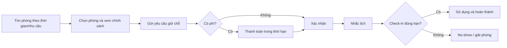
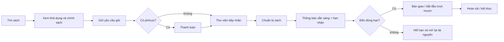
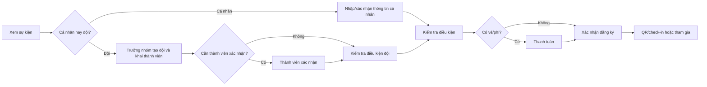

# Phân rã nghiệp vụ Campus Hub

## 1. Tầm nhìn sản phẩm

Campus Hub là cổng dịch vụ số giúp sinh viên sử dụng tài nguyên và hoạt động trong trường
nhanh hơn, đồng thời giúp nhà trường kiểm soát khả dụng, chính sách, thu phí và vận hành.

Kết quả mong muốn:

- giảm thời gian sinh viên chờ hoặc nộp đơn thủ công;
- tăng mức sử dụng phòng trống và tài nguyên thư viện;
- giảm thao tác lặp lại của nhân viên;
- minh bạch trạng thái, thời hạn, phí và trách nhiệm của các bên;
- có dữ liệu đáng tin cậy cho vận hành và đối soát.

## 2. Actor và trách nhiệm

| Actor                    | Mục tiêu                                 | Trách nhiệm/quyền chính                                            |
| ------------------------ | ---------------------------------------- | ------------------------------------------------------------------ |
| Sinh viên                | Dùng dịch vụ trường nhanh, rõ trạng thái | Tìm kiếm, gửi yêu cầu, thanh toán, hủy, check-in, nhận thông báo   |
| Trưởng nhóm              | Đăng ký đội thi                          | Khai báo đội, cung cấp liên hệ, quản lý thành viên theo chính sách |
| Thành viên đội           | Tham gia đúng đội                        | Xác nhận tham gia nếu sự kiện yêu cầu                              |
| Nhân viên cơ sở vật chất | Vận hành phòng                           | Quản lý phòng, khóa lịch, xử lý ngoại lệ, theo dõi no-show         |
| Nhân viên thư viện       | Chuẩn bị và bàn giao sách                | Tiếp nhận giữ sách, chuẩn bị, đánh dấu sẵn sàng, bàn giao/nhận trả |
| Ban tổ chức              | Vận hành sự kiện                         | Công bố, cấu hình đăng ký, duyệt nếu cần, check-in, xuất danh sách |
| Nhân viên cửa hàng       | Xử lý đơn vật phẩm                       | Quản lý catalog khả dụng, chuẩn bị và giao đơn                     |
| Tài chính                | Kiểm soát dòng tiền                      | Đối soát, hoàn tiền, xử lý sai lệch                                |
| Quản trị trường          | Quản lý chính sách và quyền              | Cấu hình, phân quyền, audit, báo cáo                               |
| Hệ thống ngoài           | Cung cấp dữ liệu/kết quả chính thức      | SSO, SIS, thư viện, thanh toán, email/push                         |

## 3. Bản đồ năng lực nghiệp vụ

### Năng lực cốt lõi

1. **Room Booking** — biến lịch phòng trống thành một quy trình tự phục vụ có kiểm soát.
2. **Library Fulfillment** — đặt trước và chuẩn bị sách trước khi sinh viên đến.
3. **Event Enrollment** — quản lý đăng ký cá nhân/đội và giới hạn tham gia.

Đây là các năng lực tạo khác biệt trực tiếp cho sản phẩm và cần ưu tiên thiết kế nghiệp vụ.

### Năng lực mở rộng

4. **Campus Commerce** — bán đồng phục và vật phẩm lưu niệm. Đây là bonus, triển khai sau
   khi ba luồng cốt lõi ổn định.

### Năng lực dùng chung

- Identity & Access
- Campus Directory
- Payment & Refund
- Notification
- Policy Management
- Audit & Reporting
- External Integration

Năng lực dùng chung hỗ trợ nhưng không được phép làm mờ quyền sở hữu của luồng cốt lõi.

## 4. Ranh giới nghiệp vụ

### 4.1 Identity & Access

Quản lý danh tính dùng trong ứng dụng, trạng thái đủ điều kiện sử dụng dịch vụ, vai trò
và phạm vi quyền. Nó trả lời “ai đang thực hiện” và “có quyền thực hiện hành động này
không”, nhưng không quyết định phòng/sách/sự kiện còn khả dụng.

### 4.2 Facility Availability

Sở hữu sự thật về phòng, sức chứa, tiện ích, giờ mở cửa, lịch học và các khoảng bị khóa.
Nó trả lời “phòng có thể được yêu cầu trong khoảng này không”. Nó không sở hữu hành trình
đặt phòng của sinh viên.

### 4.3 Room Booking

Sở hữu yêu cầu đặt phòng từ lúc giữ tạm đến khi hoàn thành, hủy hoặc no-show. Nó áp dụng
chính sách thời lượng, mục đích, phí, check-in và hủy; phối hợp với Availability và Payment.

### 4.4 Library Fulfillment

Sở hữu yêu cầu giữ sách, công việc chuẩn bị, thông báo sẵn sàng, hạn nhận, bàn giao và
hoàn trả. Catalog chuyên sâu có thể vẫn do hệ thống thư viện hiện hữu sở hữu.

### 4.5 Event Enrollment

Sở hữu sự kiện được công bố trên app, điều kiện đăng ký, đăng ký cá nhân/đội, giới hạn
suất, duyệt và check-in. Payment chỉ thu tiền; Event Enrollment quyết định đăng ký hợp lệ.

### 4.6 Campus Commerce

Sở hữu catalog bán hàng, lựa chọn sản phẩm, đơn và quá trình chuẩn bị/giao nhận. Không
dùng chung “Order” với phòng, sách hoặc vé sự kiện chỉ vì tất cả có thanh toán.

### 4.7 Payment & Refund

Sở hữu vòng đời giao dịch tiền và kết quả từ cổng thanh toán. Nó không tự xác nhận booking,
giữ sách, đăng ký sự kiện hoặc đơn hàng; nó thông báo kết quả về nghiệp vụ nguồn.

### 4.8 Policy & Administration

Sở hữu cấu hình có phiên bản, phạm vi áp dụng, quyền nhân viên, thao tác ngoại lệ và audit.
Nhân viên không được sửa dữ liệu để đi vòng qua quy tắc mà không để lại lý do và lịch sử.

## 5. Quy trình đặt phòng

### Quy tắc cần chốt

- Lịch học và khoảng khóa của trường luôn có ưu tiên cao hơn yêu cầu sinh viên.
- Một khoảng thời gian chỉ được giữ/xác nhận cho một booking có hiệu lực.
- Mỗi sinh viên/nhóm có giới hạn số booking và tổng thời lượng theo kỳ.
- Yêu cầu chưa trả phí chỉ giữ phòng trong một thời hạn ngắn.
- Chính sách hủy, hoàn tiền và no-show phải được hiển thị trước khi xác nhận.
- Check-in có thể dùng QR, vị trí, Wi-Fi trường hoặc nhân viên xác nhận; chọn một cách cho MVP.
- Cần quy định ai chịu trách nhiệm khi nhà trường buộc phải thu hồi phòng đã đặt.

### Ngoại lệ chính

- Phòng vừa được người khác giữ trước.
- Lịch chính thức được cập nhật sau khi sinh viên đã đặt.
- Thanh toán thành công muộn hoặc webhook đến lặp.
- Sinh viên hủy sát giờ, không check-in hoặc vi phạm quy định.
- Nhân viên đóng phòng khẩn cấp.

## 6. Quy trình giữ và nhận sách

### Quy tắc cần chốt

- “Chi phí mượn” phải được phân loại rõ: phí dịch vụ, tiền cọc hay phí sử dụng.
- Chỉ nhận yêu cầu khi có tài nguyên đáp ứng hoặc có hàng đợi được công bố rõ.
- Hạn chuẩn bị và hạn đến nhận là hai mốc khác nhau.
- Nhân viên có thể từ chối khi sách hỏng/thất lạc nhưng phải ghi lý do và xử lý tiền.
- Bàn giao cần xác minh đúng sinh viên và đúng tài nguyên.
- Nếu hệ thống thư viện hiện tại đã quản lý loan/fine, Campus Hub chỉ điều phối giữ và nhận.

### Ngoại lệ chính

- Catalog báo còn nhưng bản sách không thể sử dụng.
- Không chuẩn bị kịp thời hạn cam kết.
- Sinh viên không đến nhận, hủy hoặc thanh toán lỗi.
- Sinh viên đến nhận sau hạn.
- Hệ thống thư viện nguồn mất kết nối.

## 7. Quy trình đăng ký sự kiện

### Quy tắc cần chốt

- Mỗi sự kiện xác định cho phép cá nhân, đội hoặc cả hai.
- Đội có số thành viên tối thiểu/tối đa và một trưởng nhóm chịu trách nhiệm liên hệ.
- Làm rõ thành viên có bắt buộc là sinh viên trường và có phải tự xác nhận không.
- Capacity phải phân biệt số đăng ký, số người và quota theo hạng vé/đơn vị nếu có.
- Với sự kiện có duyệt, cần xác định thu tiền trước hay sau khi được duyệt.
- Thay đổi thành viên sau xác nhận phải có deadline và chính sách rõ.
- Ban tổ chức cần xuất danh sách và ghi nhận check-in mà không làm lộ dữ liệu không cần thiết.

### Ngoại lệ chính

- Sự kiện hết suất trong khi đang nhập form hoặc thanh toán.
- Thành viên xuất hiện ở nhiều đội không được phép.
- Đội chưa đủ thành viên khi hết hạn.
- Sự kiện đổi lịch, đổi địa điểm hoặc bị hủy.
- Vé đã trả tiền nhưng đăng ký không thể xác nhận.

## 8. Quy trình Campus Commerce

Luồng cơ bản: xem catalog → chọn biến thể/số lượng → chọn phương thức nhận → thanh toán →
nhân viên chuẩn bị → nhận hàng/giao hàng → hoàn thành hoặc hoàn/đổi theo chính sách.

Nghiệp vụ này là phase sau vì có thêm tồn kho, biến thể, giao nhận, đổi trả và thuế/hóa đơn.
MVP chỉ nên hỗ trợ pickup tại trường, không vận chuyển, nếu nhà trường chưa có quy trình logistics.

## 9. Quy tắc dùng chung

### Thời hạn

Mọi trạng thái giữ tạm phải có deadline rõ cho sinh viên và nhân viên. Hết hạn được xử lý
tự động, có audit và thông báo phù hợp.

### Thanh toán

- Backend tính số tiền từ chính sách hiện hành; client không quyết định số tiền cuối cùng.
- Thanh toán thành công không tự động đồng nghĩa nghiệp vụ thành công.
- Mỗi khoản thu phải tham chiếu đúng một mục đích nghiệp vụ.
- Retry, webhook lặp và kết quả đến muộn không được tạo thu tiền hoặc xác nhận trùng.
- Hoàn tiền cần lý do, người thực hiện và khả năng đối soát.

### Thông báo

Thông báo là hệ quả của thay đổi trạng thái. Không coi push/email là bằng chứng duy nhất;
trạng thái trong app luôn là nguồn sinh viên có thể kiểm tra lại.

### Audit

Cần ghi ai, khi nào, hành động gì, trên đối tượng nào, lý do và kết quả cho mọi thao tác
nhạy cảm. Không ghi bí mật, token hoặc dữ liệu thanh toán nhạy cảm vào log.

## 10. Phạm vi MVP đề xuất

### Bao gồm

- Một trường, một hoặc vài cơ sở.
- Đăng nhập và hồ sơ sinh viên.
- Tìm phòng, đặt, thanh toán nếu có, hủy, nhắc lịch và check-in đơn giản.
- Admin tối thiểu cho phòng, lịch khóa, chính sách và xử lý ngoại lệ.
- Push notification, audit và báo cáo vận hành cơ bản.

### Chưa bao gồm

- Multi-tenant thương mại hoàn chỉnh.
- Microservices, marketplace hoặc thanh toán chia tiền.
- Giao hàng vật lý phức tạp.
- Recommendation/AI, social feed hoặc chat.
- Quy trình thư viện và sự kiện đầy đủ trong release đầu tiên.

Sau khi vertical slice phòng ổn định, bổ sung thư viện rồi sự kiện. Store là phase cuối.

## 11. Chỉ số thành công

- Thời gian trung vị từ tìm phòng đến xác nhận.
- Tỷ lệ yêu cầu tự phục vụ không cần nhân viên can thiệp.
- Tỷ lệ xung đột/trùng lịch; mục tiêu vận hành là bằng 0.
- Tỷ lệ hết hạn thanh toán, hủy và no-show.
- Thời gian chuẩn bị sách và tỷ lệ sinh viên đến nhận đúng hạn.
- Tỷ lệ hoàn thành đăng ký/check-in sự kiện.
- Tỷ lệ lỗi thanh toán và chênh lệch đối soát.

## 12. Quyết định nghiệp vụ cần duyệt

### Ưu tiên P0 — phải chốt trước API/database

1. MVP phục vụ một trường hay nhiều trường ngay từ ngày đầu?
2. Nguồn danh tính và lịch học chính thức là gì; ai chịu trách nhiệm khi đồng bộ sai?
3. Phòng nào được đặt, ai đủ điều kiện, giới hạn thời lượng/tần suất là bao nhiêu?
4. Phòng miễn phí hay thu phí; thời gian giữ chờ thanh toán và chính sách hủy/no-show?
5. Check-in theo phương thức nào và sau bao lâu thì coi là no-show?
6. Khi lịch trường xung đột với booking đã xác nhận, quy trình thu hồi và hoàn tiền ra sao?

### Ưu tiên P1 — chốt trước module thư viện/sự kiện

7. Tiền sách là phí, cọc hay phí trễ hạn; hệ thống nào quản lý lượt mượn chính thức?
8. Thời gian chuẩn bị, hạn nhận và xử lý không đến nhận?
9. Đăng ký đội có cần từng thành viên xác nhận và mã sinh viên không?
10. Với sự kiện có duyệt và có phí, thu tiền trước hay sau duyệt?
11. Cổng thanh toán, SLA webhook, hoàn tiền và quy trình đối soát của trường?

### Ưu tiên P2 — trước Campus Commerce

12. Store dùng pickup hay delivery; ai sở hữu tồn kho và đổi trả?
13. Có cần hóa đơn, thuế, mã giảm giá hoặc quota mua theo sinh viên không?
