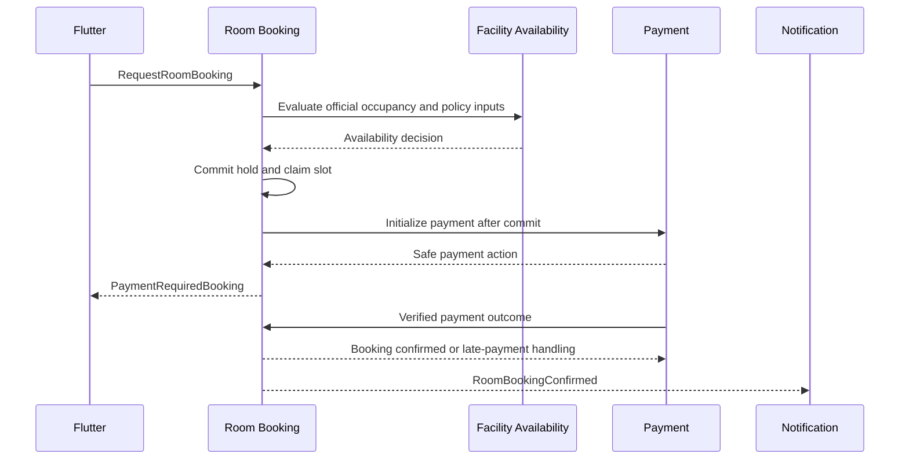
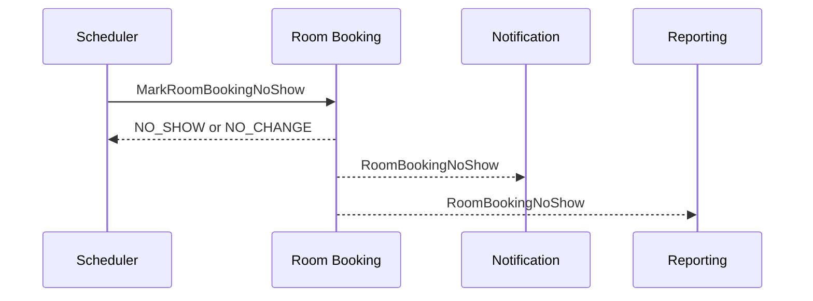

# Room Booking Application Contract — Draft

> Trạng thái: contract nội bộ trước REST API và database.
>
> Tài liệu xác định ý định, dữ liệu nghiệp vụ tối thiểu, kết quả và lỗi của application
> layer. Nó không quy định HTTP method, URL, JSON shape, ORM hay bảng PostgreSQL.

## 1. Mục tiêu

Application contract là ranh giới ổn định giữa:

- Flutter/Admin và các use case Room Booking;
- Room Booking và Facility Availability;
- Room Booking và Payment;
- tác vụ thời gian, Notification, Audit và Reporting.

Contract phải giữ nguyên ý nghĩa nếu sau này REST được thay bằng GraphQL, message consumer
hoặc internal service call.

## 2. Nguyên tắc contract

1. Actor lấy từ trusted execution context, không lấy quyền từ payload do client gửi.
2. Command thay đổi trạng thái; query chỉ đọc và không tạo hold.
3. Mọi command có khả năng retry phải có operation key duy nhất.
4. Thời gian truyền dưới dạng instant tuyệt đối; timezone chỉ dùng hiển thị.
5. Tiền là `Money`, không dùng số thực.
6. Kết quả trả về trạng thái thực sau commit, không dự đoán trước transaction.
7. Lỗi nghiệp vụ có mã ổn định và dữ liệu an toàn để UI xử lý.
8. Không trả stack trace, token, payment secret hoặc thông tin nội bộ của trường.
9. Contract không cho phép client tự gửi giá, trạng thái hoặc policy đã áp dụng.
10. Command lặp với cùng operation key và cùng nội dung trả lại kết quả cũ; cùng key nhưng
    nội dung khác bị từ chối.

## 3. Kiểu khái niệm dùng chung

Các định nghĩa sau là semantic type, chưa phải DTO:

```text
ActorContext
  actorId            danh tính đã xác thực
  institutionId      phạm vi trường
  campusScopes       các cơ sở được phép quản trị, nếu là nhân viên
  permissions        quyền đã xác minh
  correlationId      mã truy vết của thao tác

TimeRange
  startsAt           instant bắt đầu
  endsAt             instant kết thúc

Money
  amountMinor        số nguyên theo đơn vị tiền nhỏ nhất
  currency           mã tiền tệ

OperationContext
  operationKey       khóa retry/idempotency
  requestedAt        thời điểm server tiếp nhận
  actor              ActorContext
```

Mọi identifier là opaque value. Consumer không suy luận loại, tenant hoặc thời gian từ
cấu trúc identifier.

## 4. Query contract

### Q-RB-01 — SearchAvailableRooms

**Mục đích:** tìm phòng phù hợp; không giữ slot.

**Điều kiện đầu vào:**

```text
institutionId
campusId
timeRange
attendeeCount
requiredFeatures[]   tùy chọn
```

**Kết quả cho mỗi phòng:**

```text
roomId
displayName
campusSummary
capacity
features[]
availabilityObservedAt
estimatedPrice       Money hoặc miễn phí
policySummary
```

`estimatedPrice` chỉ có giá trị tham khảo. Giá và khả dụng được đánh giá lại khi tạo Booking.

### Q-RB-02 — GetRoomBooking

**Mục đích:** lấy trạng thái hiện tại và các hành động actor được phép thực hiện.

**Kết quả:**

```text
bookingId
roomSummary
timeRange
attendeeCount
purpose
status
priceSnapshot
paymentSummary       nếu có
holdExpiresAt        nếu đang chờ thanh toán
checkInWindow        nếu đã xác nhận
availableActions[]
createdAt
updatedAt
```

`availableActions` là gợi ý cho UI. Backend vẫn đánh giá lại quyền khi command được gửi.

### Q-RB-03 — ListMyRoomBookings

**Mục đích:** liệt kê booking của actor hiện tại.

**Bộ lọc nghiệp vụ:** nhóm sắp tới/đã qua, trạng thái và khoảng ngày.

**Kết quả:** danh sách tóm tắt có phân trang ổn định. Query này không cho sinh viên truyền
`bookerId` để xem booking của người khác.

### Q-RB-04 — ListOperationalBookings

**Actor:** nhân viên có quyền trong campus scope.

**Mục đích:** theo dõi booking theo phòng, thời gian, trạng thái và ngoại lệ vận hành.

Kết quả phải giới hạn dữ liệu cá nhân theo nhu cầu công việc của nhân viên.

## 5. Command contract

### C-RB-01 — RequestRoomBooking

**Actor:** sinh viên.

**Ý định:** giữ hoặc xác nhận một phòng.

**Input nghiệp vụ:**

```text
operationContext
roomId
timeRange
attendeeCount
purpose
```

**Không được nhận từ client:** giá cuối cùng, status, hold deadline, bookerId, institutionId
khác với actor context hoặc kết quả availability cũ.

**Kết quả phân biệt:**

```text
ConfirmedBooking
  bookingId
  status = CONFIRMED
  priceSnapshot
  checkInWindow

PaymentRequiredBooking
  bookingId
  status = PENDING_PAYMENT
  priceSnapshot
  holdExpiresAt
  paymentAction
```

`paymentAction` là chỉ dẫn an toàn để bắt đầu trải nghiệm thanh toán, không chứa secret của
provider. Transaction thành công phải đồng thời tạo Booking và chiếm slot; nếu một trong
hai thất bại thì không có kết quả một phần.

### C-RB-02 — RecordRoomBookingPaymentOutcome

**Actor:** trusted Payment adapter, không phải mobile client.

**Input nghiệp vụ:**

```text
operationContext
bookingId
paymentReference
outcome              SUCCEEDED hoặc FAILED
occurredAt
verifiedProviderData tham chiếu an toàn, không chứa dữ liệu thẻ
```

**Kết quả:** Booking hiện tại, hành động đã áp dụng hoặc `NO_CHANGE` nếu outcome đã được
xử lý. Thành công muộn không được phục hồi Booking đã `EXPIRED`.

### C-RB-03 — CancelRoomBooking

**Actor:** Booker.

**Input nghiệp vụ:**

```text
operationContext
bookingId
reason               tùy chọn đối với sinh viên
```

**Kết quả:**

```text
bookingId
status = CANCELLED
cancellationOutcome
  refundable
  refundAmount        nếu có
  policyExplanation
```

Command chỉ cam kết đã yêu cầu hoàn tiền nếu có; không giả vờ rằng provider đã hoàn xong.

### C-RB-04 — CheckInRoomBooking

**Actor:** Booker.

**Input nghiệp vụ:**

```text
operationContext
bookingId
roomCheckInToken
```

**Kết quả:** Booking `CHECKED_IN`, thời điểm và phương thức check-in.

Token chỉ chứng minh vị trí logic của Room; quyền, actor, trạng thái và cửa sổ thời gian
vẫn phải được kiểm tra độc lập.

### C-RB-05 — StaffCheckInRoomBooking

**Actor:** nhân viên có quyền trong campus scope.

**Input nghiệp vụ:** bookingId và lý do bắt buộc.

**Kết quả:** Booking `CHECKED_IN` cùng audit reference. Command này không dùng QR nhưng
không được bỏ qua trạng thái hoặc phạm vi quyền.

### C-RB-06 — RevokeRoomBooking

**Actor:** Facility Manager có quyền trong campus scope.

**Input nghiệp vụ:**

```text
operationContext
bookingId
reasonCode
reasonDetail
```

**Kết quả:** Booking `REVOKED` và thông tin `refundRequired` nếu đã thu tiền. Việc gửi thông
báo hoặc hoàn tiền có thể diễn ra bất đồng bộ nhưng yêu cầu tương ứng phải được ghi nhận
bền vững cùng transaction revoke.

### C-RB-07 — ExpirePaymentHold

**Actor:** trusted scheduler/worker.

**Input:** bookingId, expectedHoldDeadline và operation context.

**Kết quả:** `EXPIRED` hoặc `NO_CHANGE`. `expectedHoldDeadline` ngăn job cũ hết hạn nhầm một
hold đã được thay đổi hợp lệ.

### C-RB-08 — MarkRoomBookingNoShow

**Actor:** trusted scheduler/worker.

**Input:** bookingId, expectedCheckInDeadline và operation context.

**Kết quả:** `NO_SHOW` hoặc `NO_CHANGE`.

### C-RB-09 — CompleteRoomBooking

**Actor:** trusted scheduler/worker.

**Input:** bookingId, expectedEndAt và operation context.

**Kết quả:** `COMPLETED` hoặc `NO_CHANGE`.

## 6. Error catalog

### Validation

| Code | Ý nghĩa | UI có thể xử lý |
|---|---|---|
| `INVALID_TIME_RANGE` | Thời gian bắt đầu/kết thúc không hợp lệ | Yêu cầu chọn lại thời gian |
| `BOOKING_TOO_SOON` | Không đủ lead time 30 phút | Hiển thị thời điểm sớm nhất |
| `BOOKING_TOO_FAR_AHEAD` | Vượt booking horizon 30 ngày | Hiển thị ngày xa nhất |
| `BOOKING_DURATION_EXCEEDED` | Vượt tối đa 2 giờ | Yêu cầu rút ngắn |
| `INVALID_ATTENDEE_COUNT` | Số người không hợp lệ | Hiển thị giới hạn phòng |
| `PURPOSE_REQUIRED` | Thiếu mục đích sử dụng | Yêu cầu nhập mục đích |

### Availability và policy

| Code | Ý nghĩa | Có nên retry ngay |
|---|---|---|
| `ROOM_NOT_BOOKABLE` | Phòng không mở cho sinh viên đặt | Không |
| `ROOM_CAPACITY_EXCEEDED` | Số người vượt sức chứa | Không |
| `ROOM_OUTSIDE_OPENING_HOURS` | Nằm ngoài giờ mở cửa | Không |
| `ROOM_SLOT_UNAVAILABLE` | Slot đã bận hoặc vừa bị chiếm | Có, với slot/phòng khác |
| `ACTIVE_BOOKING_LIMIT_REACHED` | Đã có 2 booking hoạt động | Không, cho đến khi một booking kết thúc |
| `BOOKER_NOT_ELIGIBLE` | Sinh viên không đủ điều kiện | Không; liên hệ nhà trường |

### Lifecycle và authorization

| Code | Ý nghĩa |
|---|---|
| `BOOKING_NOT_FOUND` | Không tìm thấy trong phạm vi actor được phép xem |
| `BOOKING_ACTION_NOT_ALLOWED` | Trạng thái hiện tại không cho phép hành động |
| `CHECK_IN_TOO_EARLY` | Chưa mở cửa sổ check-in |
| `CHECK_IN_WINDOW_CLOSED` | Đã hết cửa sổ check-in |
| `ROOM_CHECK_IN_TOKEN_INVALID` | QR/token không hợp lệ hoặc sai phòng |
| `FORBIDDEN` | Actor không có quyền thực hiện |

### Payment và operation safety

| Code | Ý nghĩa |
|---|---|
| `PAYMENT_INITIALIZATION_FAILED` | Không thể bắt đầu thanh toán; Booking không được để ở trạng thái mồ côi |
| `PAYMENT_OUTCOME_INVALID` | Kết quả provider không xác minh được |
| `PAYMENT_RECEIVED_AFTER_EXPIRY` | Thanh toán đến sau khi hold hết hạn |
| `OPERATION_KEY_REUSED` | Cùng key được dùng cho nội dung command khác |
| `CONCURRENT_MODIFICATION` | State đã thay đổi; consumer nên tải lại trước khi thử hành động mới |

Thông báo hiển thị cho người dùng được ánh xạ từ code theo ngôn ngữ; không dùng raw exception.

## 7. Transaction boundary

### Tạo Booking

Trong cùng một transaction logic phải:

1. đánh giá lại availability và policy;
2. kiểm tra giới hạn Booking của Booker;
3. tạo Policy Snapshot;
4. tạo Booking;
5. chiếm slot;
6. ghi domain event/outbox tương ứng.

Không gọi cổng thanh toán mạng bên ngoài khi đang giữ database transaction. Với phòng có
phí, hệ thống commit hold trước, sau đó Payment khởi tạo phiên thanh toán theo event/use case.
Nếu khởi tạo thất bại không thể phục hồi, hold được hủy hoặc hết hạn an toàn.

### Transition Booking

Mỗi command khóa/kiểm tra đúng phiên bản Booking, xác minh trạng thái hiện tại, áp dụng một
transition và ghi event trong cùng transaction. Notification và analytics chạy sau commit.

### Revoke và refund

Transaction revoke phải ghi Booking `REVOKED` và yêu cầu hoàn tiền bền vững. Cổng thanh toán
được gọi ngoài transaction; kết quả được Payment xử lý idempotent.

## 8. Concurrency và idempotency

- Xung đột slot được giải quyết ở write boundary, không dựa trên cache hoặc kết quả search.
- Mỗi Booking có version để phát hiện cập nhật đồng thời.
- Operation key có scope theo actor + command type và có thời hạn lưu phù hợp.
- Payment reference duy nhất trong phạm vi provider.
- Scheduler có thể chạy nhiều instance; command thời gian phải cho kết quả `NO_CHANGE` khi
  một worker khác đã xử lý trước.
- Domain event có event ID duy nhất; consumer ghi nhận event đã xử lý.

## 9. Event envelope nội bộ

Mọi domain/integration event xuất ra ngoài module có metadata tối thiểu:

```text
eventId
eventType
eventVersion
occurredAt
aggregateId
institutionId
correlationId
causationId
actorReference       nếu có
payload
```

Payload không chứa secret hoặc dữ liệu cá nhân không cần thiết. Thay đổi breaking phải tăng
`eventVersion`; consumer không suy luận ý nghĩa từ tên topic/queue.

## 10. Luồng phối hợp chính

### Phòng có phí



### No-show



## 11. Mapping tới acceptance scenarios

| Scenario domain | Contract chịu trách nhiệm |
|---|---|
| AC-01 cạnh tranh slot | C-RB-01 + transaction/concurrency rule |
| AC-02 phòng miễn phí | C-RB-01 → `ConfirmedBooking` |
| AC-03 phòng có phí | C-RB-01 → `PaymentRequiredBooking` |
| AC-04 thanh toán đúng hạn | C-RB-02 |
| AC-05 thanh toán đến muộn | C-RB-02 + `PAYMENT_RECEIVED_AFTER_EXPIRY` |
| AC-06 vượt giới hạn | C-RB-01 + `ACTIVE_BOOKING_LIMIT_REACHED` |
| AC-07 check-in | C-RB-04 |
| AC-08 no-show | C-RB-08 |
| AC-09 nhà trường thu hồi | C-RB-06 |
| AC-10 retry an toàn | operation key + idempotency rules |

## 12. Security và privacy tại application boundary

- Query/command luôn tự giới hạn theo institution và campus scope từ ActorContext.
- `BOOKING_NOT_FOUND` có thể được dùng thay vì tiết lộ booking tồn tại nhưng thuộc người khác.
- Purpose là dữ liệu người dùng nhập, phải giới hạn độ dài và xử lý như untrusted content.
- Nhân viên chỉ thấy email/thông tin liên hệ khi cần cho vận hành cụ thể.
- QR không chứa booking ID, student ID hoặc thông tin cá nhân ở dạng đọc được.
- Audit ghi reference cần thiết, không sao chép toàn bộ payload.

## 13. Điều kiện chuyển sang REST API design

Contract sẵn sàng ánh xạ sang REST khi:

- stakeholder duyệt baseline policy tại Room Booking Domain mục 14;
- mỗi command/query có owner, quyền, input và outcome rõ;
- error catalog đủ để Flutter thiết kế UX lỗi;
- transaction boundary và late-payment flow được backend/payment cùng xác nhận;
- acceptance scenarios có test case tự động ở application/domain layer;
- chưa có khái niệm transport hoặc persistence bị rò vào domain.

