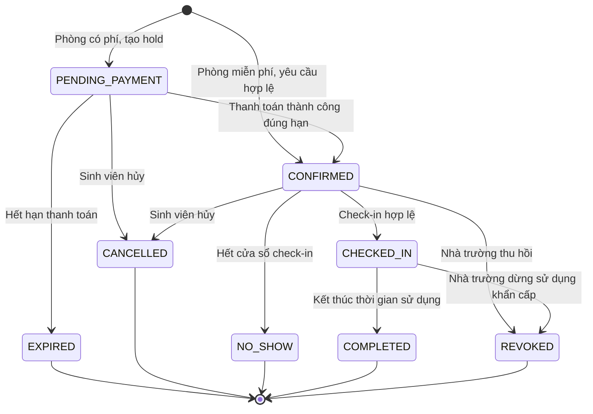

# Room Booking Domain — MVP

> Trạng thái: baseline nghiệp vụ để duyệt domain.
>
> Phạm vi: tìm phòng trống, giữ chỗ, thanh toán nếu có, xác nhận, check-in,
> hoàn thành, hủy, no-show và thu hồi bởi nhà trường.
>
> Ngoài phạm vi: API, DTO, database schema, ORM và chi tiết giao diện.

## 1. Mục tiêu nghiệp vụ

Room Booking giúp sinh viên tự tìm và đặt phòng học nhóm mà không cần nộp đơn thủ công,
đồng thời bảo đảm nhà trường luôn kiểm soát lịch chính thức, điều kiện sử dụng và thu phí.

Kết quả cần đạt:

- sinh viên biết phòng nào thực sự có thể đặt trong khoảng thời gian mong muốn;
- không có hai booking hiệu lực sử dụng cùng một phòng trong thời gian giao nhau;
- lịch học và khoảng khóa của nhà trường luôn được ưu tiên;
- booking có phí chỉ được xác nhận sau khi thanh toán hợp lệ;
- mọi hủy, hết hạn, no-show, thu hồi và hoàn tiền đều truy vết được;
- nhân viên chỉ xử lý ngoại lệ bằng hành động có quyền và có lý do.

## 2. Phạm vi MVP đã chọn

- Một trường, có thể có nhiều cơ sở.
- Sinh viên đăng nhập bằng email trường; kiến trúc sẵn sàng tích hợp SSO sau.
- Lịch học được nhập thủ công hoặc import CSV/Excel trước khi tích hợp SIS.
- Chỉ phòng được nhà trường bật quyền đặt mới xuất hiện cho sinh viên.
- Một booking kéo dài tối đa 2 giờ.
- Một sinh viên có tối đa 2 booking đang giữ hoặc đã xác nhận.
- Phòng có thể miễn phí hoặc thu phí theo chính sách.
- Booking có phí được giữ tối đa 10 phút để thanh toán.
- Check-in bằng QR trong khoảng 15 phút trước đến 15 phút sau giờ bắt đầu.
- Không check-in đúng hạn dẫn đến no-show và giải phóng phần thời gian còn lại.
- Nếu nhà trường thu hồi booking đã xác nhận, sinh viên được hoàn toàn bộ tiền đã thu.

Các con số trên phải là policy có thể cấu hình; không hard-code trong domain.

## 3. Ngôn ngữ chung

| Thuật ngữ | Ý nghĩa |
|---|---|
| Room | Phòng vật lý thuộc một cơ sở của trường |
| Official Occupancy | Khoảng thời gian phòng bận do lịch học hoặc hoạt động chính thức |
| Administrative Block | Khoảng thời gian nhân viên khóa phòng vì bảo trì hoặc lý do vận hành |
| Availability | Kết quả đánh giá một phòng có thể nhận booking tại thời điểm kiểm tra |
| Booking | Cam kết sử dụng một phòng trong một khoảng thời gian bởi một sinh viên chịu trách nhiệm |
| Hold | Quyền giữ tạm slot trong lúc chờ thanh toán |
| Booker | Sinh viên tạo booking và chịu trách nhiệm chính |
| Attendee Count | Số người dự kiến sử dụng phòng, dùng để kiểm tra sức chứa |
| Check-in Window | Khoảng thời gian cho phép xác nhận đã đến phòng |
| No-show | Booking đã xác nhận nhưng không check-in đúng hạn |
| Revoke | Nhà trường chủ động thu hồi một booking đã xác nhận |
| Policy Snapshot | Bản chụp điều kiện và giá đã áp dụng khi booking được tạo |

`Availability` là một kết quả tại một thời điểm, không phải lời bảo đảm. Hệ thống phải kiểm
tra lại toàn bộ quy tắc khi sinh viên thực sự yêu cầu giữ chỗ.

## 4. Actor và quyền hạn

### Sinh viên

- Tìm phòng theo cơ sở, thời gian, sức chứa và tiện ích.
- Xem chính sách và chi phí trước khi gửi yêu cầu.
- Tạo booking cho chính mình, thanh toán, xem trạng thái và hủy.
- Check-in booking đã xác nhận trong đúng cửa sổ thời gian.
- Không được thay đổi giá, quyền, thời gian hết hạn hoặc trạng thái trực tiếp.

### Nhân viên cơ sở vật chất

- Quản lý khả năng cho đặt của phòng và administrative block.
- Xem booking liên quan đến phạm vi cơ sở được phân quyền.
- Thu hồi booking vì lý do vận hành hợp lệ.
- Xác nhận ngoại lệ khi có quyền; mọi hành động phải có lý do và audit.

### Quản trị trường

- Cấu hình chính sách đặt phòng theo trường/cơ sở/nhóm phòng.
- Phân quyền nhân viên và xem báo cáo/audit.
- Không sửa lịch sử giao dịch đã xảy ra.

### Hệ thống thanh toán

- Thông báo kết quả thanh toán hoặc hoàn tiền.
- Không có quyền tự chuyển trạng thái Booking.

### Tác vụ thời gian

- Hết hạn hold chưa thanh toán.
- Đánh dấu no-show sau khi cửa sổ check-in đóng.
- Hoàn thành booking sau thời gian sử dụng.
- Phát hiện và retry các công việc bất đồng bộ chưa hoàn tất.

## 5. Ranh giới và trách nhiệm domain

### Facility Availability

Sở hữu Room, Official Occupancy, Administrative Block, giờ mở cửa, sức chứa và tiện ích.
Nó đánh giá khả dụng nhưng không sở hữu lifecycle của Booking.

### Room Booking

Sở hữu Booking, Policy Snapshot và các quyết định giữ, xác nhận, check-in, hủy, no-show,
hoàn thành hoặc thu hồi.

### Payment

Sở hữu quá trình thu/hoàn tiền. Room Booking chỉ yêu cầu thanh toán và phản ứng với kết quả
đã được xác minh.

### Notification

Phản ứng với domain event để gửi thông báo. Gửi thất bại không được rollback Booking.

### Identity & Access

Xác định actor, tình trạng đủ điều kiện và phạm vi quyền. Room Booking vẫn kiểm tra các
quy tắc riêng như giới hạn booking đang hoạt động.

## 6. Vòng đời Booking

### Ý nghĩa trạng thái

| Trạng thái | Ý nghĩa |
|---|---|
| `PENDING_PAYMENT` | Slot đang được giữ độc quyền trong thời hạn thanh toán |
| `CONFIRMED` | Booking hợp lệ và đã được cam kết cho sinh viên |
| `CHECKED_IN` | Sinh viên đã xác nhận có mặt đúng hạn |
| `COMPLETED` | Khoảng sử dụng đã kết thúc bình thường |
| `EXPIRED` | Hold hết hạn trước khi có thanh toán hợp lệ |
| `CANCELLED` | Sinh viên chủ động hủy |
| `NO_SHOW` | Không check-in trước khi cửa sổ đóng |
| `REVOKED` | Nhà trường thu hồi booking |

`Check-in window` là quy tắc theo thời gian, không cần trở thành một trạng thái Booking.
Trạng thái hoàn tiền thuộc Payment, không nằm trong state machine của Booking. Booking giữ
trạng thái kết thúc `CANCELLED` hoặc `REVOKED` trong khi Payment xử lý hoàn tiền độc lập.

## 7. Invariant bắt buộc

Một command chỉ thành công nếu mọi invariant liên quan đều đúng tại thời điểm commit.

### Khả dụng và xung đột

1. Không có hai Booking ở trạng thái giữ hoặc cam kết sử dụng cùng Room trong hai khoảng
   thời gian giao nhau.
2. Booking không được giao với Official Occupancy hoặc Administrative Block.
3. Room phải đang bật cho đặt và mở cửa trong toàn bộ khoảng sử dụng.
4. Kiểm tra ở màn hình tìm kiếm không thay thế kiểm tra nguyên tử lúc tạo Booking.

### Người đặt và sức chứa

5. Booker phải đang đủ điều kiện sử dụng dịch vụ tại thời điểm tạo Booking.
6. Booker không được vượt quá 2 Booking đang hoạt động (`PENDING_PAYMENT`, `CONFIRMED`
   hoặc `CHECKED_IN`) theo policy MVP.
7. Attendee Count phải lớn hơn 0 và không vượt quá sức chứa Room.
8. Booker chịu trách nhiệm cho Booking trong toàn bộ lifecycle; MVP không chuyển chủ booking.

### Thời gian

9. Thời điểm bắt đầu phải trước thời điểm kết thúc.
10. Thời lượng không vượt quá 2 giờ.
11. Booking phải thỏa lead time và booking horizon do policy quy định.
12. Mọi deadline được đánh giá theo thời gian chuẩn của server; timezone chỉ dùng để hiển thị.

### Giá và thanh toán

13. Giá được tính từ policy phía server và được snapshot khi tạo Booking.
14. Booking có phí không thể thành `CONFIRMED` nếu chưa có kết quả thanh toán hợp lệ.
15. Một kết quả thanh toán lặp không được xác nhận hoặc thu tiền hai lần.
16. Thanh toán thành công đến sau khi hold hết hạn không được phục hồi slot đã giải phóng.
17. Mọi khoản hoàn phải tham chiếu đúng Booking, khoản thu và lý do.

### Trạng thái và audit

18. Chỉ các transition được mô tả trong state machine mới hợp lệ.
19. Booking terminal không thể quay lại trạng thái hoạt động.
20. Thu hồi, override và hoàn tiền thủ công bắt buộc có actor, quyền và lý do.

## 8. Use case

### UC-RB-01 — Tìm phòng khả dụng

**Actor:** Sinh viên.

**Input nghiệp vụ:** cơ sở, khoảng thời gian, số người và tiện ích mong muốn.

**Luồng chính:**

1. Kiểm tra khoảng thời gian và tiêu chí tìm kiếm hợp lệ.
2. Xác định các phòng đang mở cho đặt và đáp ứng sức chứa/tiện ích.
3. Loại các phòng xung đột lịch chính thức, block hoặc booking đang hiệu lực.
4. Trả về phòng, chính sách áp dụng và giá ước tính.

**Kết quả:** danh sách ứng viên tại thời điểm truy vấn; không tạo hold.

### UC-RB-02 — Yêu cầu đặt phòng

**Actor:** Sinh viên.

**Tiền điều kiện:** actor đã xác thực và đủ điều kiện.

**Luồng chính:**

1. Đánh giá policy, giới hạn cá nhân, thời gian, sức chứa và khả dụng.
2. Tính giá và tạo Policy Snapshot.
3. Giữ slot nguyên tử để ngăn yêu cầu cạnh tranh.
4. Nếu miễn phí, xác nhận Booking ngay.
5. Nếu có phí, tạo hold 10 phút và yêu cầu Payment bắt đầu thu tiền.

**Kết quả:** Booking `CONFIRMED` hoặc `PENDING_PAYMENT`.

**Thất bại:** slot không còn trống, không đủ điều kiện, vượt giới hạn, thời gian/sức chứa
không hợp lệ hoặc không thể khởi tạo thanh toán.

### UC-RB-03 — Xử lý kết quả thanh toán

**Actor:** Payment adapter thông qua kết quả đã xác minh.

**Luồng chính:**

1. Nhận diện Booking và lần thanh toán tương ứng.
2. Bỏ qua an toàn nếu kết quả đã được xử lý.
3. Nếu thanh toán thành công và hold còn hiệu lực, xác nhận Booking.
4. Nếu thất bại, giữ Booking đến deadline để sinh viên có thể thử lại nếu policy cho phép.
5. Nếu thành công sau deadline, không xác nhận Booking và khởi động xử lý hoàn tiền/đối soát.

### UC-RB-04 — Hủy booking

**Actor:** Booker.

**Luồng chính:**

1. Kiểm tra Booking thuộc Booker và trạng thái cho phép hủy.
2. Tính kết quả hủy theo policy snapshot.
3. Chuyển Booking sang `CANCELLED` và giải phóng slot.
4. Nếu được hoàn tiền, yêu cầu Payment thực hiện hoàn.
5. Phát thông báo và audit.

**Ghi chú:** mức hoàn khi sinh viên chủ động hủy chưa được chốt tại mục 14.

### UC-RB-05 — Check-in

**Actor:** Booker.

**Tiền điều kiện:** Booking `CONFIRMED` và thời điểm hiện tại nằm trong cửa sổ check-in.

**Luồng chính:**

1. Xác thực QR thuộc đúng Room và còn hợp lệ.
2. Xác thực actor là Booker và Booking đang `CONFIRMED`.
3. Chuyển sang `CHECKED_IN` và ghi thời điểm/phương thức check-in.

**Thất bại:** quá sớm, quá muộn, sai phòng, QR không hợp lệ hoặc Booking không còn hiệu lực.

### UC-RB-06 — Xử lý hết hạn thanh toán

**Actor:** Tác vụ thời gian.

1. Tìm Booking `PENDING_PAYMENT` đã qua deadline.
2. Chuyển sang `EXPIRED` một cách idempotent.
3. Giải phóng slot và thông báo cho Booker.

### UC-RB-07 — Xử lý no-show

**Actor:** Tác vụ thời gian.

1. Tìm Booking `CONFIRMED` đã qua cuối cửa sổ check-in.
2. Chuyển sang `NO_SHOW` một cách idempotent.
3. Giải phóng phần thời gian còn lại và ghi nhận vi phạm theo policy.
4. Thông báo cho Booker và cập nhật chỉ số vận hành.

### UC-RB-08 — Thu hồi bởi nhà trường

**Actor:** Nhân viên có quyền trong đúng phạm vi cơ sở.

1. Kiểm tra Booking có thể thu hồi và yêu cầu lý do.
2. Chuyển sang `REVOKED`; nếu đã check-in, ghi nhận kết thúc khẩn cấp.
3. Giải phóng thời gian có thể sử dụng lại.
4. Nếu đã thu tiền, yêu cầu hoàn toàn bộ.
5. Thông báo ưu tiên cao cho Booker và ghi audit.

### UC-RB-09 — Hoàn thành booking

**Actor:** Tác vụ thời gian.

1. Tìm Booking `CHECKED_IN` đã qua giờ kết thúc.
2. Chuyển sang `COMPLETED` một cách idempotent.
3. Phát event phục vụ audit, báo cáo và đánh giá sử dụng.

## 9. Command nghiệp vụ

Command diễn tả ý định; tên không ràng buộc với HTTP hoặc queue.

| Command | Actor hợp lệ | Kết quả mong muốn |
|---|---|---|
| `RequestRoomBooking` | Sinh viên | Giữ hoặc xác nhận một slot hợp lệ |
| `RecordPaymentOutcome` | Payment adapter | Phản ứng với kết quả thu tiền đã xác minh |
| `CancelRoomBooking` | Booker | Hủy theo policy và giải phóng slot |
| `CheckInRoomBooking` | Booker | Ghi nhận có mặt đúng phòng, đúng thời gian |
| `ExpirePaymentHold` | Tác vụ thời gian | Kết thúc hold quá hạn |
| `MarkBookingNoShow` | Tác vụ thời gian | Kết thúc booking không check-in |
| `CompleteRoomBooking` | Tác vụ thời gian | Hoàn thành booking đã sử dụng |
| `RevokeRoomBooking` | Nhân viên có quyền | Thu hồi có lý do và xử lý hoàn tiền |
| `RecordRefundOutcome` | Payment adapter | Ghi nhận kết quả hoàn tiền |

Tìm kiếm khả dụng là query, không phải command và không thay đổi domain state.

## 10. Domain event

| Event | Khi phát sinh | Consumer dự kiến |
|---|---|---|
| `RoomBookingHeld` | Booking có phí giữ slot thành công | Payment, Notification, Audit |
| `RoomBookingConfirmed` | Booking được xác nhận | Notification, Audit, Reporting |
| `RoomBookingPaymentFailed` | Lần thanh toán thất bại | Notification, Audit |
| `RoomBookingExpired` | Hold hết hạn | Notification, Reporting |
| `RoomBookingCancelled` | Sinh viên hủy | Payment nếu cần hoàn, Notification, Audit |
| `RoomBookingCheckedIn` | Check-in thành công | Audit, Reporting |
| `RoomBookingNoShow` | Không check-in đúng hạn | Notification, Policy, Reporting |
| `RoomBookingCompleted` | Kết thúc sử dụng | Reporting, Audit |
| `RoomBookingRevoked` | Nhà trường thu hồi | Payment, Notification, Audit |
| `RoomBookingRefundRequested` | Domain xác định phải hoàn | Payment, Audit |
| `RoomBookingRefunded` | Hoàn tiền thành công | Notification, Finance, Audit |
| `RoomBookingRefundFailed` | Hoàn tiền cần can thiệp | Finance, Admin Alert, Audit |

Event là sự kiện đã xảy ra, dùng thì quá khứ và bất biến. Consumer phải xử lý lặp an toàn.

## 11. Policy MVP

| Policy | Giá trị mặc định | Phạm vi cấu hình |
|---|---:|---|
| Thời lượng tối đa | 2 giờ | Trường/cơ sở/nhóm phòng |
| Số booking hoạt động tối đa | 2 mỗi sinh viên | Trường |
| Thời hạn thanh toán | 10 phút | Trường/nhóm phòng |
| Mở check-in | 15 phút trước giờ bắt đầu | Trường/cơ sở |
| Đóng check-in | 15 phút sau giờ bắt đầu | Trường/cơ sở |
| Phương thức check-in | QR tại phòng | Trường/cơ sở |
| Thu hồi bởi trường | Hoàn 100% khoản đã thu | Toàn hệ thống |

Policy thay đổi chỉ áp dụng cho Booking mới. Booking đã tạo dùng Policy Snapshot để không
thay đổi điều kiện giữa chừng.

## 12. Acceptance scenarios

### AC-01 — Hai sinh viên cạnh tranh cùng slot

**Given** một phòng đang trống và hai sinh viên cùng đủ điều kiện  
**When** cả hai gửi yêu cầu cho cùng khoảng thời gian gần như đồng thời  
**Then** chỉ một yêu cầu tạo được Booking hiệu lực  
**And** yêu cầu còn lại nhận kết quả slot không còn khả dụng.

### AC-02 — Phòng miễn phí

**Given** phòng miễn phí và yêu cầu hợp lệ  
**When** sinh viên gửi yêu cầu đặt  
**Then** Booking chuyển thẳng sang `CONFIRMED`  
**And** không tạo yêu cầu thanh toán.

### AC-03 — Phòng có phí

**Given** phòng có phí và yêu cầu hợp lệ  
**When** sinh viên gửi yêu cầu đặt  
**Then** Booking ở `PENDING_PAYMENT` trong 10 phút  
**And** slot không thể được người khác đặt trong thời gian giữ.

### AC-04 — Thanh toán đúng hạn

**Given** Booking đang `PENDING_PAYMENT` và hold chưa hết hạn  
**When** kết quả thanh toán thành công được xác minh  
**Then** Booking chuyển sang `CONFIRMED` đúng một lần.

### AC-05 — Thanh toán đến muộn

**Given** hold đã hết hạn và slot đã được giải phóng  
**When** kết quả thanh toán thành công đến muộn  
**Then** Booking không được phục hồi  
**And** trường hợp được chuyển sang luồng hoàn tiền/đối soát.

### AC-06 — Vượt giới hạn cá nhân

**Given** sinh viên đã có 2 Booking hoạt động  
**When** sinh viên yêu cầu Booking thứ ba  
**Then** yêu cầu bị từ chối trước khi thu tiền.

### AC-07 — Check-in đúng hạn

**Given** Booking `CONFIRMED`, đúng QR phòng và nằm trong cửa sổ check-in  
**When** Booker check-in  
**Then** Booking chuyển sang `CHECKED_IN`.

### AC-08 — No-show

**Given** Booking vẫn `CONFIRMED` sau khi cửa sổ check-in đóng  
**When** tác vụ no-show chạy  
**Then** Booking chuyển sang `NO_SHOW` một lần  
**And** phần thời gian còn lại được giải phóng.

### AC-09 — Nhà trường thu hồi

**Given** Booking đã xác nhận và đã thu tiền  
**When** nhân viên có quyền thu hồi với lý do hợp lệ  
**Then** Booking chuyển sang `REVOKED`  
**And** phát sinh yêu cầu hoàn 100%  
**And** sinh viên được thông báo.

### AC-10 — Retry an toàn

**Given** cùng một command hoặc kết quả thanh toán được gửi lặp  
**When** hệ thống xử lý lại  
**Then** không tạo thêm Booking, transition, khoản thu hoặc khoản hoàn trùng.

## 13. Yêu cầu audit và báo cáo

### Audit tối thiểu

- actor và vai trò;
- hành động và Booking liên quan;
- trạng thái trước/sau;
- thời điểm chuẩn của server;
- policy snapshot hoặc phiên bản policy;
- lý do đối với hủy bởi nhân viên, revoke, override và refund;
- correlation giữa Booking và giao dịch tiền.

### Chỉ số MVP

- thời gian từ tìm kiếm đến xác nhận;
- tỷ lệ xung đột bị ngăn chặn;
- conversion từ hold sang confirmed;
- tỷ lệ hết hạn thanh toán;
- tỷ lệ hủy và no-show;
- mức sử dụng phòng theo cơ sở/khung giờ;
- tỷ lệ booking cần nhân viên can thiệp;
- tổng thu, hoàn và sai lệch cần đối soát.

## 14. Baseline quyết định MVP

Các mặc định dưới đây được chọn để tiếp tục thiết kế. Chúng có thể thay đổi khi nhà trường
duyệt chính sách, nhưng phải được khóa trước khi chốt API và database migration đầu tiên.

1. Lead time tối thiểu là 30 phút; booking horizon tối đa là 30 ngày.
2. Hủy từ 2 giờ trước giờ bắt đầu được hoàn 100%; hủy muộn hơn không hoàn phí.
3. No-show không được hoàn phí và được ghi nhận vi phạm; MVP chưa tự động khóa tài khoản.
4. Attendee Count tối thiểu là 1 để không loại trừ nhu cầu học cá nhân.
5. MVP chỉ thu thập số người và mục đích sử dụng, không thu danh sách thành viên.
6. MVP dùng QR tĩnh gắn tại phòng, chứa định danh không nhạy cảm; server xác thực Room,
   Booker và cửa sổ thời gian. Không hỗ trợ check-in offline.
7. Nhân viên có quyền có thể check-in thay trong trường hợp ngoại lệ, bắt buộc ghi lý do.
8. Facility Manager duyệt thu hồi khi lịch mới xung đột; hệ thống thông báo ngay và hoàn
   100% nếu đã thu tiền.
9. MVP không sửa thời gian, đổi phòng hoặc gia hạn; sinh viên phải hủy và đặt lại.
10. Phòng mở cho sinh viên đặt được xác nhận tự động; phòng cần duyệt thủ công không được
    đưa vào catalog đặt phòng của MVP.

## 15. Điều kiện hoàn thành bước domain

Room Booking domain được coi là đủ để chuyển sang thiết kế contract nội bộ vì đã có baseline
ở mục 14. Trước khi khóa API production vẫn cần:

- state machine và invariant được stakeholder nghiệp vụ duyệt;
- nhân viên cơ sở vật chất xác nhận các ngoại lệ vận hành;
- tài chính xác nhận chính sách thu/hủy/hoàn;
- các acceptance scenario quan trọng được chuyển thành test domain tự động.

