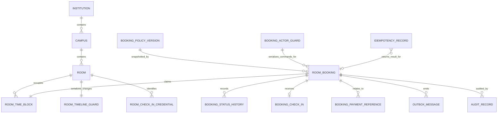

# Room Booking Logical Data Model — Draft

> Trạng thái: logical model trước physical PostgreSQL schema và migration.
>
> Tài liệu xác định dữ liệu nào tồn tại, module nào sở hữu, quan hệ và invariant cần bảo
> vệ. Tên bảng/cột, kiểu PostgreSQL, index SQL và Prisma mapping chưa được khóa.

## 1. Mục tiêu

Logical model phải hỗ trợ:

- tìm availability từ lịch chính thức, block vận hành và booking;
- tạo hold nguyên tử để hai sinh viên không chiếm cùng slot;
- quản lý lifecycle Booking và policy snapshot;
- giới hạn tối đa hai booking hoạt động mỗi sinh viên;
- xử lý payment outcome, cancellation, check-in, no-show và revoke idempotent;
- audit đầy đủ mà không lưu dư dữ liệu cá nhân;
- outbox đáng tin cậy cho Payment, Notification và Reporting;
- tách quyền sở hữu dữ liệu giữa các module trong modular monolith.

## 2. Nguyên tắc dữ liệu

1. Mỗi record nghiệp vụ có `institution_id` để bảo vệ ranh giới trường.
2. ID là opaque và duy nhất; quan hệ tenant-sensitive phải ngăn tham chiếu chéo trường.
3. Thời gian lưu dưới dạng instant UTC; timezone của trường dùng khi hiển thị và tính lịch.
4. Khoảng sử dụng là nửa mở `[starts_at, ends_at)` để hai booking nối tiếp không xung đột.
5. Tiền lưu bằng integer `amount_minor` cùng `currency`.
6. Booking không bị hard delete; kết thúc bằng trạng thái terminal và lịch sử transition.
7. Dữ liệu phục vụ invariant không chỉ nằm trong JSON.
8. Policy snapshot là immutable để thay đổi policy không làm đổi booking cũ.
9. Raw token, access token, QR token và payment secret không được lưu dạng rõ.
10. Mọi ghi dữ liệu và outbox event tương ứng phải commit cùng transaction.

## 3. Quyền sở hữu dữ liệu

| Module | Sở hữu | Module khác được làm gì |
|---|---|---|
| Identity & Access | User/student identity, eligibility, role | Room Booking chỉ giữ `booker_id` reference và snapshot hiển thị tối thiểu khi cần |
| Campus Directory | Institution, Campus | Module khác chỉ tham chiếu |
| Facility Availability | Room, Room Time Block, QR credential | Room Booking yêu cầu claim/release qua public port |
| Policy & Administration | Phiên bản Room Booking Policy | Booking đọc policy có hiệu lực và lưu snapshot |
| Room Booking | Booking, status history, check-in/cancellation/revoke facts | Không module nào cập nhật trực tiếp trạng thái |
| Payment | Payment intent/transaction/refund | Booking giữ reference và phản ứng với verified outcome |
| Platform | Idempotency record, outbox message, audit record | Dùng qua shared infrastructure contract |

Không dùng foreign key logic như một lý do để module ghi trực tiếp vào bảng module khác.
Trong modular monolith, một application use case có thể phối hợp nhiều repository/port trong
cùng transaction nhưng vẫn phải đi qua contract sở hữu.

## 4. Sơ đồ logical entity



Các entity `INSTITUTION`, `CAMPUS`, identity và payment aggregate chỉ là external reference
trong scope này; logical model không sao chép toàn bộ dữ liệu do module khác sở hữu.

## 5. Facility Availability entities

### 5.1 Room

Đại diện phòng vật lý có thể xuất hiện trong availability.

**Thuộc tính logic:**

- `room_id`
- `institution_id`
- `campus_id`
- `display_name`
- `capacity`
- `bookable_by_students`
- `opening_policy_reference`
- `active`
- `version`

Tiện ích phòng thuộc Facility và có thể là relation riêng. Room Booking chỉ cần kết quả
đánh giá sức chứa/tiện ích, không snapshot toàn bộ Room vào aggregate.

### 5.2 Room Time Block

Là occupancy ledger thống nhất cho mọi khoảng thời gian ngăn phòng được đặt.

**Thuộc tính logic:**

- `time_block_id`
- `institution_id`
- `campus_id`
- `room_id`
- `time_range`
- `source_type`: `OFFICIAL_OCCUPANCY`, `ADMIN_BLOCK`, `ROOM_BOOKING`
- `source_reference`
- `state`: `ACTIVE`, `RELEASED`
- `release_reason`
- `created_at`
- `released_at`
- `version`

**Invariant:** một active block nguồn `ROOM_BOOKING` không được giao với bất kỳ active block
nào khác của cùng Room. Hai blocker không phải booking, ví dụ `OFFICIAL_OCCUPANCY` và
`ADMIN_BLOCK`, được phép giao nhau vì chúng có thể mô tả hai lý do phòng cùng không khả dụng.

Booking `PENDING_PAYMENT`, `CONFIRMED` hoặc `CHECKED_IN` có đúng một active block nguồn
`ROOM_BOOKING`. Khi Booking kết thúc/hủy/hết hạn/no-show/revoke, block được release trong
cùng transaction với transition.

Ledger thống nhất giúp availability có một nguồn blocker chung. Mọi thao tác insert/release
block phải khóa Room Timeline Guard trước khi kiểm tra overlap và ghi thay đổi.

### 5.3 Room Timeline Guard

Record kỹ thuật một-một với Room để serialize mọi thay đổi có thể ảnh hưởng availability.

**Thuộc tính logic:**

- `institution_id`
- `room_id`
- `version`

Tạo booking, import lịch chính thức, tạo administrative block và release block đều khóa
guard này. Nhờ vậy booking không thể vượt qua một lịch chính thức được insert đồng thời.
Physical PostgreSQL constraint vẫn được dùng làm defense-in-depth cho booking overlap.

### 5.4 Room Check-in Credential

Đại diện QR tĩnh gắn tại Room.

**Thuộc tính logic:**

- `credential_id`
- `institution_id`
- `room_id`
- `token_hash`
- `active_from`
- `revoked_at`
- `version`

Chỉ lưu hash của token. Có thể phát hành credential mới và revoke credential cũ mà không
đổi Room. QR không chứa Student ID hoặc Booking ID.

## 6. Policy entity

### 6.1 Booking Policy Version

Policy là cấu hình có version và thời gian hiệu lực.

**Thuộc tính logic:**

- `policy_version_id`
- `institution_id`
- phạm vi áp dụng: trường, campus hoặc nhóm phòng
- `effective_from`, `effective_until`
- lead time, booking horizon, max duration
- active booking limit
- payment hold duration
- check-in window
- cancellation/refund rule
- no-show rule
- `published_by`, `published_at`

Không sửa in-place policy đã publish. Thay đổi tạo version mới.

## 7. Room Booking entities

### 7.1 Room Booking

Aggregate root của lifecycle đặt phòng.

**Identity và scope:**

- `booking_id`
- `institution_id`
- `campus_id`
- `room_id`
- `booker_id`

**Yêu cầu sử dụng:**

- `starts_at`, `ends_at`
- `attendee_count`
- `purpose`

**Lifecycle:**

- `status`
- `hold_expires_at` khi `PENDING_PAYMENT`
- `checked_in_at` khi đã check-in
- `completed_at` khi hoàn thành
- `terminal_reason_code` khi cancel/no-show/revoke/expire
- `version`
- `created_at`, `updated_at`

**Price và policy snapshot:**

- `price_amount_minor`, `price_currency`
- `policy_version_id`
- `policy_snapshot`

`policy_snapshot` chứa đầy đủ giá trị cần giải thích quyết định sau này. Những giá trị cần
lọc, tính toán hoặc enforce thường xuyên vẫn có field logic riêng thay vì chỉ nằm trong JSON.

**Không lưu:**

- trạng thái refund như trạng thái Booking;
- raw payment payload;
- toàn bộ hồ sơ sinh viên;
- danh sách thành viên nhóm trong MVP;
- dữ liệu Room dễ thay đổi ngoài reference và snapshot hiển thị nếu thực sự cần hóa đơn/audit.

### 7.2 Booking Status History

Append-only record của mỗi transition hợp lệ.

**Thuộc tính logic:**

- `history_id`
- `institution_id`
- `booking_id`
- `from_status`, `to_status`
- `transition_type`
- `actor_type`, `actor_reference`
- `reason_code`, `reason_detail`
- `occurred_at`
- `correlation_id`, `causation_id`
- metadata an toàn theo transition

History hỗ trợ giải thích và audit, nhưng trạng thái hiện tại vẫn nằm trên aggregate để kiểm
tra invariant và query hiệu quả. Không rebuild aggregate từ history trong MVP.

### 7.3 Booking Check-in

Fact chi tiết về check-in thành công; một Booking có tối đa một fact.

**Thuộc tính logic:**

- `check_in_id`
- `institution_id`
- `booking_id`
- `method`: `ROOM_QR`, `STAFF_OVERRIDE`
- `checked_in_at`
- `credential_id` nếu dùng QR
- `actor_reference`
- `override_reason` nếu nhân viên thực hiện
- `correlation_id`

Không lưu raw QR token.

### 7.4 Booking Payment Reference

Liên kết tối thiểu với Payment aggregate mà không sao chép sổ cái thanh toán.

**Thuộc tính logic:**

- `booking_payment_reference_id`
- `institution_id`
- `booking_id`
- `payment_reference`
- `purpose`: `CHARGE`, `REFUND`
- `requested_amount_minor`, `currency`
- `created_at`

Payment module sở hữu trạng thái và provider data. Reference duy nhất giúp Booking nhận biết
outcome lặp và giúp audit/đối soát nối hai aggregate.

### 7.5 Booking Actor Guard

Record kỹ thuật thuộc Room Booking dùng để serialize các command làm thay đổi quota của
một Booker.

**Thuộc tính logic:**

- `institution_id`
- `booker_id`
- `version`

Khi tạo/hủy/expire/no-show/revoke/complete, transaction khóa guard tương ứng trước khi đếm
booking hoạt động. Điều này ngăn hai request đồng thời đều thấy Booker đang có một booking
rồi cùng tạo booking thứ hai và thứ ba.

Guard không lưu `active_count` trong MVP để tránh counter bị lệch. Count được tính từ Booking
trong transaction sau khi guard đã bị khóa.

## 8. Platform entities

### 8.1 Idempotency Record

**Thuộc tính logic:**

- `idempotency_record_id`
- `institution_id`
- `actor_id`
- `operation_scope`
- `operation_key`
- `request_fingerprint`
- `state`: `PROCESSING`, `COMPLETED`, `FAILED_FINAL`
- `result_reference` hoặc response snapshot an toàn
- `created_at`, `completed_at`, `expires_at`

**Uniqueness:** một `(institution, actor, operation_scope, operation_key)`.

Cùng key và fingerprint trả kết quả cũ. Cùng key nhưng fingerprint khác bị từ chối. Không
lưu token/secret trong request hoặc response snapshot.

### 8.2 Outbox Message

**Thuộc tính logic:**

- `message_id`
- `institution_id`
- `aggregate_type`, `aggregate_id`
- `event_type`, `event_version`
- `payload`
- `occurred_at`
- `correlation_id`, `causation_id`
- `publish_state`
- `attempt_count`, `next_attempt_at`, `published_at`

Outbox được ghi cùng transaction với Booking transition. Publisher có thể retry; consumer
phải deduplicate theo `message_id`.

### 8.3 Audit Record

**Thuộc tính logic:**

- `audit_id`
- `institution_id`
- `actor_type`, `actor_reference`
- `action`
- `subject_type`, `subject_reference`
- `reason_code`
- `occurred_at`
- `correlation_id`
- before/after summary đã lọc dữ liệu nhạy cảm

Audit append-only, có retention và quyền đọc riêng. Domain history và audit có thể cùng phát
sinh nhưng phục vụ hai mục đích: history giải thích lifecycle; audit phục vụ kiểm soát.

## 9. Quan hệ và cardinality

| Quan hệ | Cardinality | Quy tắc |
|---|---|---|
| Campus → Room | 1:N | Room thuộc đúng một campus trong MVP |
| Room → Time Block | 1:N | Mọi occupancy hiệu lực đi qua ledger |
| Room → Timeline Guard | 1:1 | Mọi mutation timeline khóa cùng guard |
| Room Booking → Time Block | 1:1 | Block nguồn booking tồn tại từ khi hold được tạo; sau đó có thể released |
| Policy Version → Room Booking | 1:N | Booking giữ thêm snapshot immutable |
| Booker → Room Booking | 1:N | Tối đa hai booking ở trạng thái hoạt động theo policy |
| Room Booking → Status History | 1:N | Có record cho transition tạo ban đầu và mọi transition tiếp theo |
| Room Booking → Check-in | 1:0..1 | Chỉ tạo khi check-in thành công |
| Room Booking → Payment Reference | 1:N | Có thể có charge và một hoặc nhiều lần xử lý refund/retry theo Payment policy |
| Booking → Outbox | 1:N | Mỗi domain event có message ID riêng |

## 10. Constraint logic

### Cấp record

- `starts_at < ends_at`.
- `attendee_count > 0`.
- `price_amount_minor >= 0`.
- `currency` hợp lệ.
- `hold_expires_at` bắt buộc chỉ khi `PENDING_PAYMENT`.
- Check-in fact chỉ tồn tại nếu Booking đã từng chuyển sang `CHECKED_IN`.
- Staff override bắt buộc có actor, permission audit và reason.

### Cấp quan hệ

- Room, Campus, Booking, Time Block và Policy reference cùng Institution.
- Booking có đúng một Time Block nguồn `ROOM_BOOKING`.
- Payment reference không được gắn với hai Booking.
- Một Booking chỉ có một Check-in fact.
- Status history không được update/delete qua luồng nghiệp vụ thông thường.

### Cấp transaction

- Active booking Time Block không giao với active block nào của cùng Room; blocker không
  phải booking có thể giao nhau.
- Một Booker không vượt active booking limit.
- Transition tuân theo state machine và optimistic version.
- Transition terminal release active Time Block trong cùng transaction.
- Booking mutation và outbox message commit cùng nhau.
- Idempotency result chỉ `COMPLETED` sau khi transaction nghiệp vụ commit.

## 11. Transaction flow

### 11.1 Tạo Booking

```text
1. Begin transaction.
2. Claim/lock Idempotency Record.
3. Lock Booking Actor Guard.
4. Lock Room Timeline Guard.
5. Kiểm tra eligibility và đếm active Booking.
6. Đọc policy version có hiệu lực, Room và occupancy hiện tại.
7. Tính price và tạo immutable policy snapshot.
8. Tạo Room Booking.
9. Tạo active Room Time Block; reject nếu overlap.
10. Tạo initial Status History và Outbox Message.
11. Complete Idempotency Record.
12. Commit.
13. Khởi tạo Payment ngoài transaction nếu cần.
```

Nếu bước 8 xung đột, toàn bộ transaction rollback. Nếu Payment initialization thất bại sau
commit, application thực hiện compensation idempotent để cancel/release hold hoặc để hold
hết hạn theo policy; không để Booking được xác nhận mà không có payment.

### 11.2 Payment thành công

```text
1. Claim payment outcome idempotency.
2. Lock Booking theo version/current state.
3. Nếu PENDING_PAYMENT và chưa quá deadline: CONFIRMED.
4. Nếu đã EXPIRED: không phục hồi; yêu cầu Payment xử lý hoàn/đối soát.
5. Ghi Status History + Outbox.
6. Commit.
```

### 11.3 Cancel, expire, no-show, complete hoặc revoke

```text
1. Claim operation idempotency.
2. Xác định Booker/Room, sau đó lock Booking Actor Guard, Room Timeline Guard và Booking
   theo thứ tự lock chuẩn.
3. Kiểm tra state/version/policy/permission.
4. Chuyển trạng thái.
5. Release Room Time Block nếu đang active.
6. Ghi fact/history/audit/outbox tương ứng.
7. Commit.
```

### 11.4 Import lịch chính thức gây xung đột

Official Occupancy có ưu tiên, nhưng không được insert cưỡng bức làm hỏng invariant:

1. Xác định các Booking block giao với lịch mới.
2. Facility Manager/system policy phê duyệt danh sách revoke.
3. Trong transaction khóa Room Timeline Guard, sau đó revoke các Booking liên quan và
   release booking block.
4. Insert Official Occupancy block.
5. Ghi history, audit và outbox yêu cầu thông báo/hoàn tiền.
6. Commit.

Nếu không thể hoàn tất toàn bộ, không publish lịch chính thức một phần cho Room đó.

## 12. Query/read model

### Availability query

Kết hợp Room đủ điều kiện với active Room Time Block giao khoảng tìm kiếm. Giá ước tính lấy
từ Policy version hiện hành, không lấy từ Booking cũ.

### My bookings

Đọc Room Booking theo `(institution_id, booker_id)` và thời gian. Room summary có thể join
qua Facility read contract hoặc projection; không sao chép Room thành nguồn dữ liệu thứ hai.

### Operational list

Đọc theo campus, time range và status. Booker contact chỉ được lấy qua privacy-aware identity
projection dành cho staff có quyền.

### Payment summary

Booking detail có thể compose từ Booking và Payment query contract. Nếu cần tối ưu sau khi
đo tải, tạo read projection cập nhật bằng event; projection không trở thành nguồn quyết định.

## 13. Logical index/access paths

Chưa khóa loại index vật lý, nhưng schema phải phục vụ các đường truy cập:

- active Time Block theo Room, source type và khoảng thời gian;
- Booking theo Booker + status + starts_at;
- Booking theo Campus/Room + time range + status;
- Booking theo hold deadline cho worker expiry;
- Booking theo check-in deadline cho worker no-show;
- Booking theo end time cho worker completion;
- history theo Booking + occurred_at;
- idempotency theo institution + actor + scope + key;
- outbox chưa publish theo next_attempt_at;
- audit theo institution + subject + occurred_at.

Physical design phải chứng minh query plan bằng dữ liệu thử có quy mô gần production.

## 14. Retention và privacy

- Booking và financial references giữ theo yêu cầu tài chính/pháp lý của trường.
- Purpose và reason detail là dữ liệu do người dùng nhập; giới hạn độ dài và quyền xem.
- Booker contact không snapshot vào Booking trừ khi có yêu cầu pháp lý rõ ràng.
- QR chỉ lưu hash; raw token không xuất hiện trong log/audit/outbox.
- Idempotency response snapshot được xóa sớm hơn lịch sử nghiệp vụ khi hết thời hạn retry.
- Outbox payload đã publish có thể archive; audit append-only có retention riêng.
- Quy trình anonymization phải giữ được báo cáo tổng hợp và đối soát mà không giữ PII dư thừa.

## 15. Mapping từ domain invariant

| Invariant | Cơ chế logical |
|---|---|
| Không trùng lịch | Unified Room Time Block + Room Timeline Guard + booking no-overlap constraint |
| Lịch chính thức ưu tiên | Import conflict workflow + revoke transaction |
| Tối đa hai booking hoạt động | Booking Actor Guard + transactional count |
| Hold 10 phút | `hold_expires_at` + expiry worker |
| Giá không thay đổi | Price fields + immutable Policy Snapshot |
| Thanh toán lặp an toàn | Payment Reference + idempotency record |
| Transition hợp lệ | Aggregate state/version + status history |
| Terminal giải phóng phòng | State transition và Time Block release cùng transaction |
| Notification không mất | Transactional Outbox |
| Nhân viên không sửa âm thầm | Permission + reason + audit record |

## 16. Quyết định cho physical PostgreSQL design

Bước tiếp theo cần chốt cách hiện thực, không thay đổi logical model:

1. Dùng PostgreSQL range type + partial exclusion constraint nào cho booking Time Block,
   kết hợp Room Timeline Guard ra sao.
2. Cách Prisma quản lý constraint/index PostgreSQL không biểu diễn trực tiếp được.
3. Chuẩn ID: UUIDv7, ULID hoặc UUID thông thường.
4. Policy snapshot dùng JSONB với schema version nào.
5. Idempotency response lưu snapshot, result reference hay kết hợp.
6. Partition/archival threshold cho Time Block, history, outbox và audit.
7. Worker claim dùng row lock/skip-locked hay queue bên ngoài.
8. Quy tắc composite foreign key để chống cross-tenant reference.
9. Transaction isolation level và retry policy cho serialization/deadlock.
10. Cơ chế mã hóa field nếu trường yêu cầu bảo vệ PII ở cấp ứng dụng.

Thứ tự lock logic thống nhất để giảm deadlock là: Idempotency Record → Booking Actor Guard →
Room Timeline Guard → Room Booking. Use case không cần một loại guard phải bỏ qua vị trí đó
nhưng không đảo thứ tự các lock còn lại.

## 17. Điều kiện hoàn thành logical model

- Facility, Booking, Payment và Platform thống nhất quyền sở hữu entity.
- DBA/backend xác nhận no-overlap và actor quota có thể enforce nguyên tử.
- Mọi state transition quan trọng có history, outbox và audit phù hợp.
- Payment xác nhận reference đủ cho charge/refund/reconciliation.
- Security xác nhận dữ liệu cá nhân tối thiểu và retention.
- Các transaction flow được chuyển thành integration test scenario.
- Chưa có quyết định ORM làm thay đổi ngôn ngữ domain.

